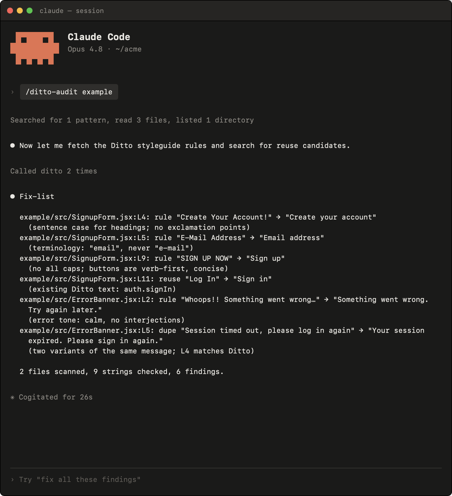
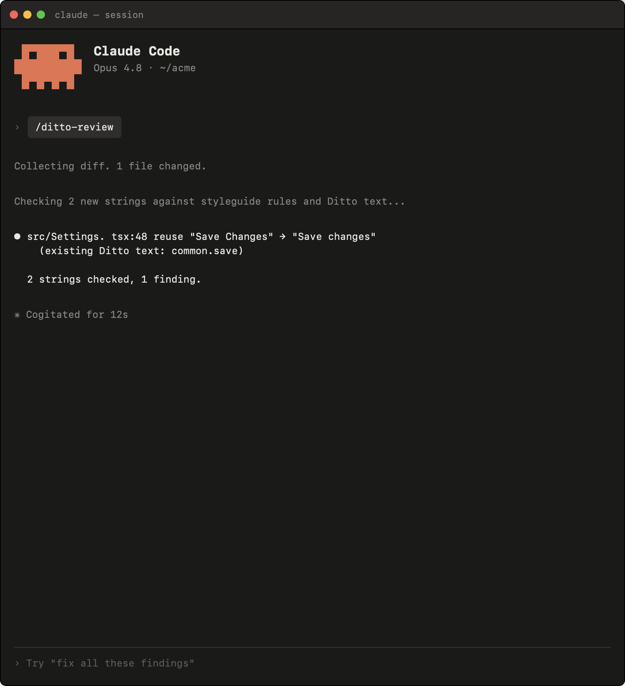

# Ditto Agent Setup Package

Ditto's bundled agent integration:

- [Ditto MCP server](https://developer.dittowords.com/mcp-reference/overview)
- Session hooks: every session starts with instructions to consult Ditto for user-facing copy,
  without you prompting it.
- `/ditto-review`: check the current diff's user-facing strings against your
  styleguide rules and existing Ditto text; returns a fix-list.
- `/ditto-audit [path]`: check the path for user-facing strings against your
  styleguide rules and existing Ditto text; returns a fix-list.
- `/ditto-spec-audit [component]`: (for repos using Ditto specs) audit every
  instance of a specced component across the codebase against its spec's
  rules.
- `/ditto-spec-component <component>`: (for repos using Ditto specs) analyze a component, create or update
  its Ditto spec file (and specs for child components that lack one), and sync
  styleguide rules from the platform.
- `/ditto-spec-gaps [component]`: (for repos using Ditto specs) find copy patterns across component
  instances that should be styleguide rules but aren't; create approved ones
  on the platform.

The `/ditto-spec-audit`, `/ditto-spec-component`, and `/ditto-spec-gaps` skills
work on repos set up for Ditto Specs. See the [agent skills
reference](https://developer.dittowords.com/ditto-specs-cli-reference/agent-skills)
for the full explanation of each.

## Install

### Claude Code

```
/plugin marketplace add dittowords/ditto-agent-setup
/plugin install ditto@ditto
```

Restart Claude Code and approve the ditto MCP server (if not approved already).

Then log in: run `/mcp`, select **ditto**, and choose **Authenticate**. A
browser tab opens for you to log in to Ditto and approve access. There's no
token to create — the MCP server uses OAuth.

Need a static credential instead — for continuous integration, a headless
agent, or machine-to-machine access? See [Authenticating with an API
token](https://developer.dittowords.com/mcp-reference/installation#authenticating-with-an-api-token)
in the installation guide, and configure the server yourself rather than
through this package.

### Cursor

In Cursor's Dashboard, go to **Plugins**, then under Team Marketplaces choose
**Add Marketplace** → **Import from Repo** and paste
`https://github.com/dittowords/ditto-agent-setup`. Install the **ditto**
plugin from that marketplace.

To try it without a marketplace, clone this repo into
`~/.cursor/plugins/local/ditto` and restart Cursor.

Then log in: open **Settings → MCP & Integrations**, find the **ditto** server,
and authenticate. A browser tab opens for you to log in to Ditto and approve
access — same OAuth flow, no token to create.

The plugin ships the same skills and always-on copy instructions as the Claude
Code plugin; in Cursor the instructions load as an always-applied rule, and the
skills are model-invoked or typed as `/ditto-review`, `/ditto-audit`, and so on.

### Optional: set up Ditto Specs

The specs CLI reads a Ditto API token directly, so this part does need one. If you don't have a key handy, create a new one in Developers > API Keys.

Add your API key as a value accessible from the terminal like so:

```bash
export DITTO_TOKEN=<your-api-token>
```

[Ditto Specs](https://developer.dittowords.com/ditto-specs-cli-reference/overview) are `*.ditto.md` files that co-locate copy rules with your components. Run  
`/ditto-spec-setup` and the agent will install the  
specs CLI if missing, creates `dittospec.config.json` and  
`workspace.ditto.md`, and scaffolds component spec files.

With specs in place `/ditto-spec-audit`, `/ditto-spec-component`, and `/ditto-spec-gaps` become usable.

## Try it on the example

The `[example/](example)` directory contains sample components seeded with
copy problems (inconsistent casing, "Log in" vs "sign in", shouty errors).
From this repo:



And `/ditto-review` does the same for just your working diff, useful right
before a commit:


